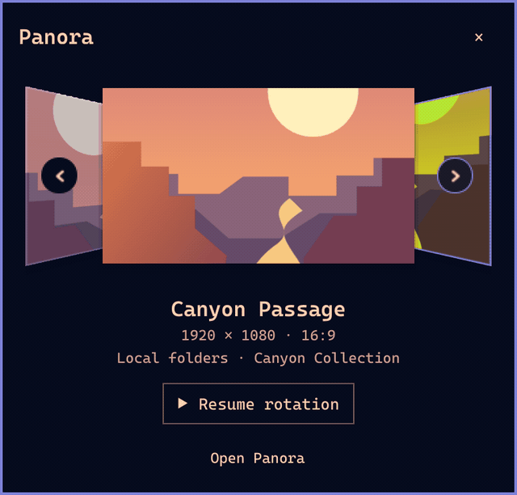

# Panora

[](https://github.com/vadim82/panora/actions/workflows/go.yml)
[](https://github.com/vadim82/panora/releases/latest)
[](LICENSE)

**A wallpaper rotator for Omarchy and Apple silicon Macs.**

Keep your favorite wallpapers in rotation while discovering new ones. Mix local folders,
saved Wallhaven searches, and saved Alpha Coders searches. Decide which images
qualify for your screen, and let Panora change the wallpaper in the background.
On Omarchy, the active theme’s wallpapers can join the same rotation.

[Install on Omarchy](#install-on-omarchy) ·
[Install on macOS](#install-on-macos-apple-silicon) ·
[What Panora can do](#what-panora-can-do)

[](assets/screenshots/panora-bar-cover-flow.mp4)

[Watch Cover Flow from the Omarchy bar](assets/screenshots/panora-bar-cover-flow.mp4).
The [desktop app demo](assets/screenshots/panora-demo.mp4) shows the full window
and History controls.

## What Panora can do

### Mix your collection with new wallpapers

Add as many sources as you need and turn each one on or off independently.
Online discovery is opt-in and limited to family-friendly results.

| Source | What you can add |
| --- | --- |
| [Local folders](docs/providers/local.md) | Your JPEG, PNG, and static WebP files |
| [Wallhaven](docs/providers/wallhaven.md) | Saved searches with keywords, tags, categories, and colors |
| [Alpha Coders](docs/providers/alpha-coders.md) | Saved searches with tag autocomplete, a result check with thumbnails, and your personal API key |
| [Omarchy theme](docs/providers/omarchy.md) | The active theme’s still backgrounds on Omarchy |
| [Provider plugins](docs/providers/README.md#custom-provider-programs) | Additional collections from trusted installed providers |

By default, **Balance sources** gives each eligible provider an equal chance,
so a large folder collection doesn’t crowd out Wallhaven. Choose **Shuffle
all images** to give each distinct eligible image in the loaded collection an
equal chance. [Rotation settings](docs/configuration.md#rotation-mode)

### Set shared filters or tune each source

Set a shared minimum resolution and aspect ratio in **Settings**. Sources set
to **Use shared rules** follow those settings. For example, set a shared
minimum of 2560 × 1440, then give *night skies* its own 5120 × 1440 minimum and
32:9 aspect ratio. [Image rules](docs/configuration.md#image-rules-for-each-source)

Once Panora picks an image, choose how it looks on the desktop. **Fit** shows
the whole image and **Crop** fills the display on supported setups.
[Picture fit](docs/fit.md)

### Preview, skip, and revisit

Set the rotation interval, preview neighboring wallpapers when available, and
pause or skip whenever you want. Replay a wallpaper from **History**, or
exclude it from future rotation and restore it later. Rotation keeps running
when you close the window. Control it from the app, the CLI, the Omarchy bar,
or the macOS menu bar. [User guide](docs/ui.md#everyday-use)

### Add image-provider plugins

Panora supports plugins that discover images from other services or collections.
Install a trusted external provider with `panora provider install DIRECTORY`
and restart Panora’s service. Providers with a compatible editor manifest can
expose their settings in **Sources**. [Provider guide and protocol](docs/providers/README.md#custom-provider-programs)

## Install on Omarchy

### Install with yay

[Add Panora’s signed package repository](https://vadim82.github.io/panora/)
once. Run `omarchy update` and let it finish, then install Panora.

```sh
yay -S panora
```

The first update refreshes the Panora package list and applies pending system
updates. Future Panora releases arrive with your normal **Update → Omarchy**.

### Download from GitHub Releases

Download the Arch Linux x86-64 package and `SHA256SUMS` from
[GitHub Releases](https://github.com/vadim82/panora/releases). Save both files
in an empty directory, then verify and install the package from that directory.

```sh
sha256sum --check SHA256SUMS &&
  sudo pacman -U ./panora-*-x86_64.pkg.tar.zst
```

For release notifications, select **Watch → Custom → Releases** on GitHub.
To upgrade a direct download, verify and install the new package the same way.

### Open Panora

Open **Panora** from the Omarchy launcher. On first launch, it starts with
the active theme’s wallpapers, and the app follows the theme’s colors. On
Omarchy 4.5, the package adds playback controls to the bar on first use.

See [Omarchy setup and removal](integrations/omarchy/README.md#install-from-the-marketplace)
for managing or removing the bar widget.

## Install on macOS (Apple silicon)

Panora has a native Mac window and menu bar controls. Turn on **Start Panora at
login** in Settings to start rotation automatically. Your current wallpaper
follows you as you visit ordinary Desktops in Spaces. [macOS guide](docs/macos.md) · [Platform coverage](docs/status.md)

### Install with Homebrew

Install Panora by its full formula name to trust only Panora from this tap.

```sh
brew tap vadim82/panora https://github.com/vadim82/panora.git
brew install vadim82/panora/panora
open "$(brew --prefix vadim82/panora/panora)/libexec/Panora.app"
```

See the [macOS user guide](docs/macos.md#install-with-homebrew-on-apple-silicon)
for upgrades and removal.

### Download from GitHub Releases

Download the ad-hoc signed preview from
[GitHub Releases](https://github.com/vadim82/panora/releases/latest) for Apple
silicon Macs running macOS 26.7.2 or later. The release notes explain the
checksum and what to expect from Gatekeeper when opening the preview.

For local development, see [building `Panora.app` from source](docs/macos-development.md#build-and-install).

## Documentation and contributing

See the [user guide](docs/ui.md), [CLI](docs/cli.md), and
[configuration reference](docs/configuration.md). See the
[Arch build guide](docs/arch.md#build-from-a-recorded-revision) for source
builds and [platform status](docs/status.md) for verified coverage and
experimental backends.

[Contribute](CONTRIBUTING.md) · [Report a bug](https://github.com/vadim82/panora/issues) ·
[Report a vulnerability privately](SECURITY.md)

## License

Panora's original code and documentation and the
[selected canyon artwork](assets/branding/README.md) are licensed under the
[MIT License](LICENSE). Third-party material retains its own terms. Other
Panora artwork requires separate licensing confirmation.
