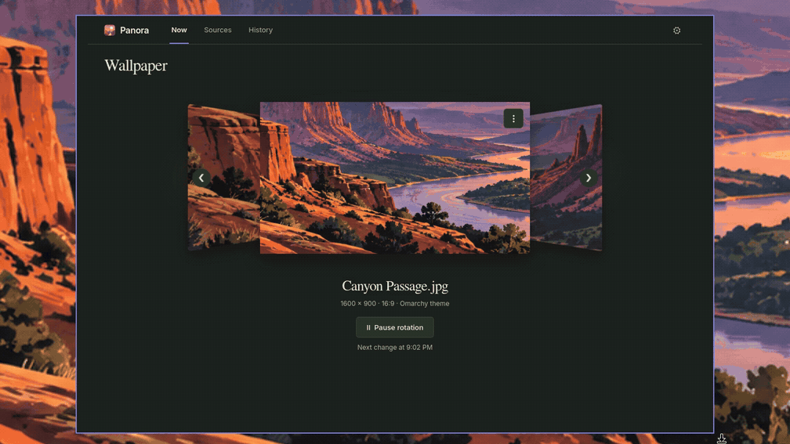

# Panora

[](https://github.com/vadim82/panora/actions/workflows/go.yml)
[](https://github.com/vadim82/panora/releases/latest)
[](LICENSE)

**A wallpaper rotation you can make your own on Omarchy and macOS.**

Mix your own folders and saved Wallhaven searches in one rotation. Find new
images that fit your screen, go back to ones you liked, and exclude the ones
you’d rather skip. On Omarchy, you can also include the active theme’s
wallpapers.

[](assets/screenshots/panora-demo.mp4)

[Watch the Omarchy demo](assets/screenshots/panora-demo.mp4) ·
[Install on Omarchy](#install-on-omarchy) ·
[Install on macOS](#install-on-macos-apple-silicon)

## Make the rotation yours

- **Mix your sources.** Add local folders and save separate Wallhaven searches
  such as *wide landscapes* and *night skies*. Give each source its own size
  and aspect-ratio rules. **Balance sources** gives each eligible provider an
  equal chance, so Wallhaven gets a turn alongside a large local library.
- **See what’s next.** Step through wallpaper previews in **Now**. Pause or
  skip from the app, the CLI, the Omarchy bar, or the macOS menu bar.
  Rotation continues after you close the window.
- **Revisit or exclude.** Replay an earlier wallpaper from **History** or
  exclude an image from future rotation. Restore it from **Excluded** if you
  change your mind.

## Install on Omarchy

### Install with yay

[Add Panora’s signed package repository](https://vadim82.github.io/panora/)
once. Run `omarchy update` and let it finish, then install Panora.

```sh
yay -S panora
```

The first update refreshes the Panora package list and applies pending system
updates. Future Panora releases arrive with your normal **Update → Omarchy**.

### Download from GitHub Releases

Download the Arch Linux x86-64 package and `SHA256SUMS` from
[GitHub Releases](https://github.com/vadim82/panora/releases). Save both files
in an empty directory, then verify and install the package from that directory.

```sh
sha256sum --check SHA256SUMS &&
  sudo pacman -U ./panora-*-x86_64.pkg.tar.zst
```

For release notifications, select **Watch → Custom → Releases** on GitHub.
To upgrade a direct download, verify and install the new package the same way.

### Open Panora

Open **Panora** from the Omarchy launcher. On first launch, it starts with
the active theme. Online discovery is opt-in and uses safe-for-work Wallhaven
results. On Omarchy 4.5, the package adds playback controls to the bar on
first use.

See [Omarchy setup and removal](integrations/omarchy/README.md#install-from-the-marketplace)
for managing or removing the bar widget.

## Install on macOS (Apple silicon)

Panora has a native Mac window and menu bar controls. Start with a local
folder or a saved Wallhaven search, and turn on **Start Panora at login**
in Settings if you want rotation to start automatically. The menu bar stays
available when you quit the window, and your current wallpaper follows you
as you visit ordinary Desktops in Spaces.

### Install with Homebrew

Install Panora by its full formula name to trust only Panora from this tap.

```sh
brew tap vadim82/panora https://github.com/vadim82/panora.git
brew install vadim82/panora/panora
open "$(brew --prefix vadim82/panora/panora)/libexec/Panora.app"
```

See the [macOS user guide](docs/macos.md#install-with-homebrew-on-apple-silicon)
for upgrades and removal.

### Download from GitHub Releases

Download the ad-hoc signed preview from
[GitHub Releases](https://github.com/vadim82/panora/releases/latest) for Apple
silicon Macs running macOS 26.7.2 or later. The release notes explain the
checksum and what to expect from Gatekeeper when opening the preview.

For local development, see [building `Panora.app` from source](docs/macos-development.md#build-and-install).

## Documentation and contributing

See the [user guide](docs/ui.md), [CLI](docs/cli.md), and
[configuration reference](docs/configuration.md). See the
[Arch build guide](docs/arch.md#build-from-a-recorded-revision) for source
builds and [platform status](docs/status.md) for verified coverage and
experimental backends.

[Contribute](CONTRIBUTING.md) · [Report a bug](https://github.com/vadim82/panora/issues) ·
[Report a vulnerability privately](SECURITY.md)

## License

Panora's original code and documentation and the
[selected canyon artwork](assets/branding/README.md) are licensed under the
[MIT License](LICENSE). Third-party material retains its own terms. Other
Panora artwork requires separate licensing confirmation.
